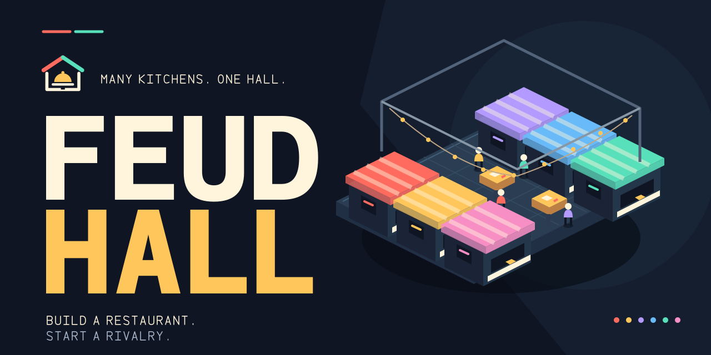

# Feud Hall artwork

Editable, self-contained SVG masters for the game. All illustrations and lettering
are vector paths and shapes: no embedded bitmaps, installed fonts, external
resources, scripts, or rendering filters are needed. Change the output dimensions
when rasterizing to generate PNGs directly from the vectors.

The emblem puts two contrasting roof slopes over one hall and a golden serving
cloche. Coral and mint suggest rival restaurants sharing a space. The social
illustration expands this into six colorful stalls, shared seating, diners, and
warm overhead lights. The six accent colors are a brand palette; they do not
establish cuisine-to-color assignments in game content.

## Masters and uses

| Source | Canvas | Use |
| --- | --- | --- |
| [feud-hall-icon.svg](feud-hall-icon.svg) | 512 × 512 | Application/package icon, including Flatpak and `.deb` artwork; avatars. Midnight tile with transparent outer corners. |
| [feud-hall-favicon.svg](feud-hall-favicon.svg) | 64 × 64 | Optically simplified browser favicon; prefer this drawing for 16–48 px outputs. |
| [feud-hall-mark.svg](feud-hall-mark.svg) | 512 × 512 | Transparent emblem for dark surfaces and custom compositions. |
| [feud-hall-logo.svg](feud-hall-logo.svg) | 1500 × 360 | Transparent horizontal emblem and wordmark for dark surfaces. |
| [feud-hall-social.svg](feud-hall-social.svg) | 1280 × 640 | Opaque social/banner composition, including a GitHub social preview. Keep its 2:1 ratio. |

The icon and social composition have their own background. The transparent mark
and wordmark use warm ivory and are designed to sit on a dark background. Preserve
aspect ratios and the built-in clear space. Use the square icon or favicon for
square placements; use the wide composition for banners.

A ready-to-upload [GitHub social preview PNG](feud-hall-social.png) is included
at 1280 × 640 pixels. Regenerate it from `feud-hall-social.svg` when that master
changes; the SVG remains the editable source.



## Palette

| Color | Hex | Role |
| --- | --- | --- |
| Midnight | `#101523` | Background and negative space |
| Warm ivory | `#FFF4DC` | Lettering and structure |
| Coral | `#FF6B5E` | Primary roof and stall accent |
| Mint | `#58E0BB` | Opposing roof and stall accent |
| Gold | `#FFC75B` | Serving dish, wordmark accent, lights |
| Violet | `#B39AFF` | Additional stall accent |
| Blue | `#68BAF8` | Additional stall accent |
| Pink | `#F78FC4` | Additional stall accent |

## Exporting PNGs

The following commands use `rsvg-convert` from librsvg and run from the repository
root. The same sources can be opened in an SVG editor for manual export. Keep the
SVGs as the editable sources; generate raster artifacts for distribution.

```sh
mkdir -p build/artwork

rsvg-convert --width 512 --height 512 \
  --output build/artwork/feud-hall-icon-512.png \
  assets/branding/feud-hall-icon.svg

rsvg-convert --width 32 --height 32 \
  --output build/artwork/feud-hall-favicon-32.png \
  assets/branding/feud-hall-favicon.svg

rsvg-convert --width 1280 --height 640 \
  --output build/artwork/feud-hall-social-1280x640.png \
  assets/branding/feud-hall-social.svg
```

For another resolution, substitute proportional width/height values. For example,
the icon can be rendered at 256 × 256 or 1024 × 1024, the wordmark at 750 × 180,
and the social composition at 2560 × 1280. Render each target from the SVG rather
than enlarging an already exported PNG. Packaging jobs should select the
appropriate master and generate their required sizes during CI.

These are original vector illustrations and custom geometric letterforms authored
for this repository, supplied under the repository's [license](../../LICENSE).
